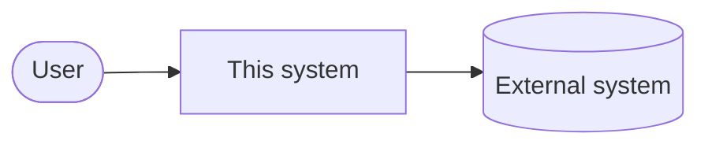

# Architecture Overview

Status: Not designed
Last verified against code: —

Descriptive: this document records the architecture **as it is**, not as intended. Accepted ADRs and contracts remain authoritative. Where this document and the code disagree, the code is the fact and the gap is reported. Agents keep this file current and report every update. `/map` regenerates it.

Label every claim:
- **[fact]**: observed, with evidence (file path, config, test, trace).
- **[inference]**: derived from facts, with reasoning.
- **[hypothesis]**: plausible but unverified.
- **[unknown]**: not yet determined.

## 1. System context (C4 level 1)

Users, external systems, and the boundary of this system.

## 2. Containers (C4 level 2)

Deployable/runnable units, their responsibilities, technology (per ADR), and communication.

| Container | Responsibility | Technology / ADR | Evidence |
| --- | --- | --- | --- |

## 3. Components (C4 level 3)

Main modules per container, and which specs they implement (from `implements:` annotations).

| Component | Path | Implements | Depends on | Evidence |
| --- | --- | --- | --- | --- |

## 4. Data and state

Persistent data, ownership, state machines (link spec algorithms), consistency guarantees.

## 5. Runtime flows

Key processes are documented in [`docs/map/flows/`](../map/flows/).

## 6. Cross-cutting concerns

Security, privacy, observability, error handling, configuration.

## 7. Deviations from intent

Places where the implementation diverges from accepted specs, ADRs, or contracts. Each is reported to the human, not silently fixed in either direction.
