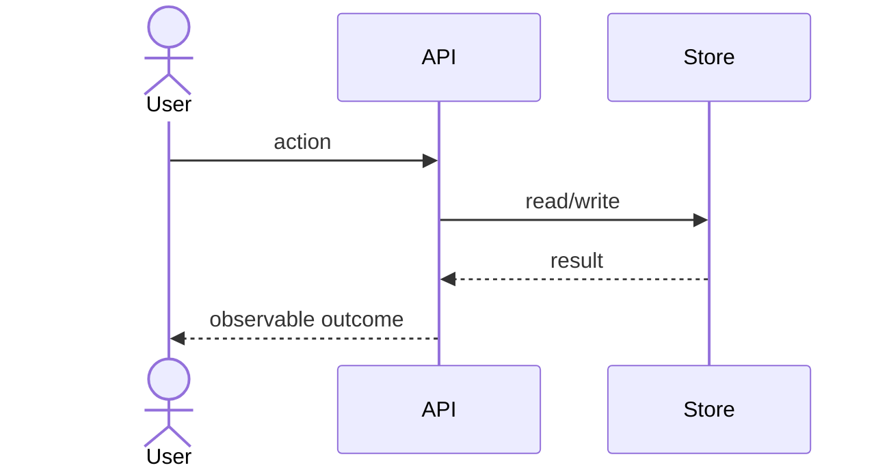

# Flow: name of the process

Trigger: what starts it (user action, event, schedule).
Specs: SPEC-NNN (rules SPEC-NNN-R1, …)
Last verified against code: YYYY-MM-DD, commit `…`

> Copy to `docs/map/flows/NNN-slug.md`. Descriptive: label claims [fact] / [inference] / [hypothesis] / [unknown].

| # | Step | Rule | Code (evidence) | Label |
| --- | --- | --- | --- | --- |
| 1 | … | SPEC-NNN-R1 | `path/to/file:line` | [fact] |

## Failure paths

| Failure | Where detected | Observable outcome | Rule |
| --- | --- | --- | --- |
